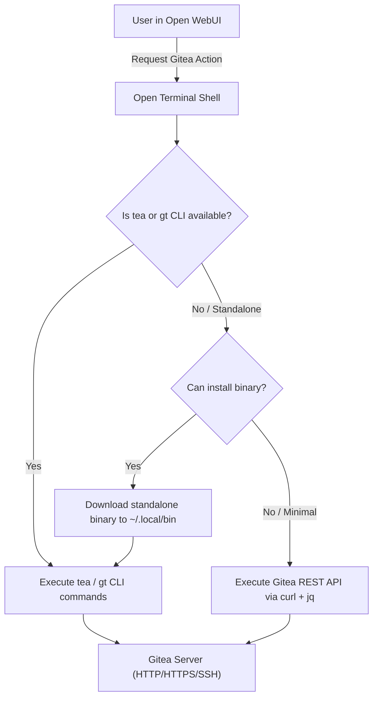

# Gitea CLI & Open Terminal Playbook

This skill guides operations, repository workflows, and automation with [Gitea](https://about.gitea.com/) within Open WebUI's **Open Terminal** environment. It supports both the official Gitea CLI (`tea` / `gt`) and direct REST API execution via `curl` and `jq`.

---

## 1. Architecture & Environment Setup

When Open WebUI interacts with Gitea through Open Terminal, commands run inside the terminal container substrate:



### Environment Variables

Export these variables in your Open Terminal session:

```bash
export GITEA_URL="${GITEA_URL:-https://git.spencer.lan}"
export GITEA_TOKEN="${GITEA_TOKEN:-}"
export GITEA_USER="${GITEA_USER:-}"
export GITEA_SSH_KEY_FILE="${GITEA_SSH_KEY_FILE:-$HOME/.ssh/id_rsa}"

# If using self-signed TLS certificates in a homelab:
export GITEA_INSECURE="${GITEA_INSECURE:-false}"
```

> [!IMPORTANT]
> **Avoid Interactive Prompts**: Open Terminal commands must execute non-interactively. Never run commands that spawn interactive text editors (`nano`, `vi`) or interactive password prompts. Always provide titles, bodies, and tokens as command-line arguments or environment variables.

---

## 2. Installing the Gitea CLI (`tea`) in Open Terminal

If neither `tea` nor `gt` is installed in the Open Terminal container, install the precompiled standalone `tea` binary into `~/.local/bin` (no `sudo` required):

```bash
install_tea() {
  mkdir -p ~/.local/bin
  export PATH="$HOME/.local/bin:$PATH"

  if command -v tea >/dev/null 2>&1; then
    echo "[+] tea is already installed: $(tea --version)"
    return 0
  fi

  ARCH=$(uname -m)
  case "$ARCH" in
    x86_64)  TEA_ARCH="amd64" ;;
    aarch64) TEA_ARCH="arm64" ;;
    armv7l)  TEA_ARCH="arm-6" ;;
    *)       TEA_ARCH="amd64" ;;
  esac

  echo "[*] Downloading tea CLI for linux-$TEA_ARCH..."
  curl -fsSL "https://dl.gitea.com/tea/0.9.2/tea-0.9.2-linux-$TEA_ARCH" -o ~/.local/bin/tea \
    || curl -fsSL "https://github.com/go-gitea/tea/releases/download/v0.9.2/tea-0.9.2-linux-$TEA_ARCH" -o ~/.local/bin/tea

  chmod +x ~/.local/bin/tea
  echo "[+] Installed tea CLI: $(~/.local/bin/tea --version)"
}

install_tea
```

---

## 3. Configuring Authentication

### 1. Configure `tea` Login Profile

Configure `tea` non-interactively using your personal access token:

```bash
INSECURE_FLAG=""
[ "${GITEA_INSECURE:-false}" = "true" ] && INSECURE_FLAG="--insecure"

# Add or update login profile named 'homelab'
tea login add \
  --name homelab \
  --url "$GITEA_URL" \
  --token "$GITEA_TOKEN" \
  $INSECURE_FLAG

# Set as default active login
tea login default homelab

# Verify login status
tea login list
```

### 2. Configure Git Credentials (for `git push` & `git clone`)

Ensure local git commands can push and pull without prompting for credentials. Use in-memory credential caching rather than unencrypted disk storage:

```bash
# Cache credentials in memory for 1 hour (avoids plaintext on disk)
git config --global credential.helper 'cache --timeout=3600'

# Clone securely via HTTP authorization header (avoids token in .git/config):
git -c http.extraHeader="Authorization: token ${GITEA_TOKEN}" clone "${GITEA_URL}/owner/my-repo.git"
```

---

## 4. Repository Operations with `tea`

### 1. List Repositories
```bash
# List repositories accessible to your account
tea repos

# List repositories belonging to a specific user or organization
tea repos list --owner my-org
```

### 2. Create a New Repository
```bash
# Create public repository
tea repos create --name "my-awesome-app" --description "Built with Open WebUI"

# Create private repository
tea repos create --name "internal-infra" --description "Internal configs" --private
```

### 3. Clone a Repository
```bash
# Clone using tea (infers Gitea context)
tea clone owner/my-repo

# Alternatively via standard git preserving protocol scheme:
PROTO="${GITEA_URL%%://*}"
HOST_PATH="${GITEA_URL#*://}"
git clone "${PROTO}://${GITEA_USER}:${GITEA_TOKEN}@${HOST_PATH%/}/owner/my-repo.git"
```

### 4. Inspect Repository Details
```bash
cd my-repo
tea repo
```

---

## 5. Issue Tracking Workflows

### 1. List Issues
```bash
# List open issues for current repository context
tea issues

# List open issues with details
tea issues list --state open --fields index,title,state,author,labels

# List closed issues
tea issues list --state closed
```

### 2. Create an Issue
Always pass `--title` and `--body` explicitly to prevent `tea` from opening a text editor:

```bash
tea issues create \
  --title "Fix database reconnection timeout" \
  --body "When OpenBao re-authenticates, connections drop before retry logic completes." \
  --labels "bug,high-priority"
```

### 3. View Issue Details & Comments
```bash
ISSUE_ID=12
tea issue "$ISSUE_ID"
```

### 4. Comment on an Issue
```bash
tea comment "$ISSUE_ID" "Investigating this now. Will push a fix to branch fix-reconnect."
```

### 5. Close / Reopen an Issue
```bash
tea issues close "$ISSUE_ID"
# Or: tea issues reopen "$ISSUE_ID"
```

---

## 6. Pull Request (PR) Workflows

### 1. List Pull Requests
```bash
# List open PRs
tea pr

# List all PRs including merged
tea pr list --state all
```

### 2. Create a Pull Request
Push your branch to Gitea and create the PR:

```bash
git checkout -b feature/dynamic-valves
git add .
git commit -m "Add dynamic valve resolution"
git push -u origin feature/dynamic-valves

tea pr create \
  --head feature/dynamic-valves \
  --base main \
  --title "Add dynamic valve resolution" \
  --description "Improves credential discovery without requiring container restarts."
```

### 3. Checkout a PR Locally for Testing
```bash
tea pr checkout 5
```

### 4. Review & Approve a PR
```bash
# Approve with comment
tea pr review 5 --approve --comment "Verified test suite passes on Ubuntu 24.04."

# Request changes
tea pr review 5 --reject --comment "Please add unit tests for token expiration."
```

### 5. Merge a PR
```bash
# Squash and merge
tea pr merge 5 --style squash

# Standard merge commit
tea pr merge 5 --style merge

# Rebase and merge
tea pr merge 5 --style rebase
```

---

## 7. Releases & Tags

```bash
# List recent releases
tea releases

# Create a new release with assets
tea releases create \
  --tag "v1.2.0" \
  --title "Release v1.2.0" \
  --note "Automated deployment and Ubuntu SSH client integration." \
  --asset dist/package.tar.gz
```

---

## 8. Fallback: Gitea REST API via `curl` + `jq`

When `tea` cannot be downloaded or installed, interact directly with Gitea's Swagger/OpenAPI REST endpoints:

### Common Header Setup
```bash
GITEA_API="${GITEA_URL%/}/api/v1"
CURL_AUTH=(-H "Authorization: token $GITEA_TOKEN" -H "Content-Type: application/json")

if [ "$GITEA_INSECURE" = "true" ]; then
  CURL_AUTH+=("-k")
fi
```

### 1. Verify User Credentials
```bash
curl -sS "${CURL_AUTH[@]}" "$GITEA_API/user" | jq '{login: .login, email: .email, is_admin: .is_admin}'
```

### 2. List User Repositories
```bash
curl -sS "${CURL_AUTH[@]}" "$GITEA_API/user/repos?limit=20" \
  | jq '.[] | {name: .name, full_name: .full_name, private: .private, clone_url: .clone_url}'
```

### 3. Create a Repository
```bash
curl -sS "${CURL_AUTH[@]}" -X POST "$GITEA_API/user/repos" \
  -d '{
    "name": "homelab-tools",
    "description": "Custom administration scripts",
    "private": true,
    "auto_init": true
  }' | jq '{name: .name, clone_url: .clone_url}'
```

### 4. List Issues
```bash
OWNER="my-org"
REPO="my-repo"

curl -sS "${CURL_AUTH[@]}" "$GITEA_API/repos/$OWNER/$REPO/issues?state=open&limit=20" \
  | jq '.[] | {number: .number, title: .title, user: (.user.login // .user.username), comments: .comments}'
```

### 5. Create an Issue
```bash
curl -sS "${CURL_AUTH[@]}" -X POST "$GITEA_API/repos/$OWNER/$REPO/issues" \
  -d '{
    "title": "Automated Backup Failure",
    "body": "Nightly backup failed at 02:00 UTC due to disk quota.",
    "labels": [1, 3]
  }' | jq '{number: .number, title: .title, url: .html_url}'
```

### 6. Create a Pull Request
```bash
curl -sS "${CURL_AUTH[@]}" -X POST "$GITEA_API/repos/$OWNER/$REPO/pulls" \
  -d '{
    "title": "Support SSH Ed25519 Keys",
    "body": "Adds support for ed25519 private keys in SSH client tool.",
    "head": "feature/ed25519",
    "base": "main"
  }' | jq '{number: .number, title: .title, state: .state}'
```

### 7. Merge a Pull Request
```bash
PR_INDEX=5

curl -sS "${CURL_AUTH[@]}" -X POST "$GITEA_API/repos/$OWNER/$REPO/pulls/$PR_INDEX/merge" \
  -d '{
    "Do": "squash",
    "MergeMessageField": "Squash and merge PR #5"
  }' | jq .
```

---

## 9. Troubleshooting & Edge Cases

| Issue / Error | Cause | Resolution |
| :--- | :--- | :--- |
| **`tea: command not found`** | Binary not in container `$PATH`. | Run the `install_tea` bash snippet in Section 2 to install to `~/.local/bin/tea`. |
| **Terminal hangs indefinitely** | `tea` opened an interactive editor ($EDITOR) for issue/PR body. | Always supply body via `--body "..."` or `--description "..."` on the command line. |
| **`x509: certificate signed by unknown authority`** | Gitea server uses private CA or self-signed cert. | Pass `--insecure` in `tea login add`, or pass `-k` to `curl` and scope git trust: `git config --global http."${GITEA_URL%/}/".sslVerify false`. |
| **`401 Unauthorized` / `token expired`** | Token is missing, incorrect, or lacks required scopes. | Generate a new token in Gitea under **Settings > Applications > Generate New Token** with `repo`, `issue`, and `user` scopes. |
| **`404 Not Found` when creating PR** | Head branch does not exist on remote or was not pushed. | Run `git push -u origin <branch>` before creating the pull request. |
