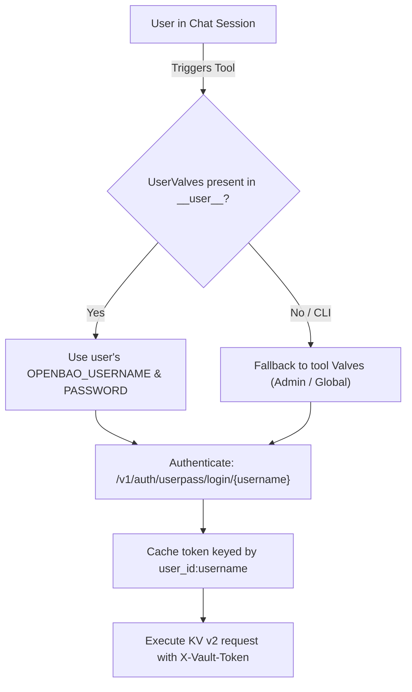

# OpenBao KV Client Skill

This skill guides the inspection, operation, testing, and troubleshooting of the OpenBao / HashiCorp Vault KV v2 secrets client ([`tools/openbao_client.py`](file:///Users/jspencer/projects/open-webui_tools/tools/openbao_client.py)) within Open WebUI and standalone CLI environments.

---

## 1. Architecture & Credential Resolution

The client uses a dual-tier configuration architecture leveraging Open WebUI's Pydantic model inspection:



### Multi-Tenant Credential Isolation
- **User Scoping**: Session tokens are cached strictly per Open WebUI user identity (`__user__["id"]:username`). Unprivileged users cannot hijack sessions established by other users.
- **Automatic Renewal**: When a token expires (HTTP 401/403), the client invalidates the cached token, re-authenticates automatically, and retries the request once.

### Configuration Tiers
1. **Tool Valves (`Valves`)**: Configured globally in **Workspace > Tools > Settings**.
   - `OPENBAO_ADDR`: Base URL of the vault endpoint (e.g. `https://vault.example.com`).
   - `SECRETS_MOUNT`: KV v2 mount point (default: `kv`).
   - `OPENBAO_SKIP_TLS_VERIFY`: Boolean flag to disable certificate validation for self-signed certificates.
   - `REQUEST_TIMEOUT`: Network timeout in seconds (default: 10s).
   - `OPENBAO_USERNAME` / `OPENBAO_PASSWORD`: Optional fallback credentials.
2. **User Valves (`UserValves`)**: Configured per user in chat controls (**Controls > Valves**).
   - `OPENBAO_USERNAME`: Personal userpass username.
   - `OPENBAO_PASSWORD`: Personal userpass password (`type: "password"`).
   - Stored in Open WebUI's database (`webui.db`) and persisted across chat sessions.

---

## 2. Supported Operations & API Endpoints

The tool targets OpenBao / HashiCorp Vault KV v2 REST APIs:

### 1. List Secrets
- **Tool Method**: `list_secrets(path=None, __user__=None)`
- **Vault API**: `GET /v1/{mount}/metadata?list=true` or `GET /v1/{mount}/metadata/{path}?list=true`
- **Returns**: `list[str]` of keys available under the root mount or specified subpath.

### 2. Read Secret
- **Tool Method**: `read_secret(path, __user__=None)`
- **Vault API**: `GET /v1/{mount}/data/{path}`
- **Returns**: `dict` containing the latest secret key/value data (extracted from `payload["data"]["data"]`).

### 3. Write / Update Secret
- **Tool Method**: `write_secret(path, data, __user__=None)`
- **Vault API**: `POST /v1/{mount}/data/{path}` with body `{"data": data}`
- **Returns**: `dict` response payload with version metadata.

### 4. Logout / Revocation
- **Tool Method**: `logout(__user__=None)`
- **Vault API**: `POST /v1/auth/token/revoke-self`
- **Behavior**: Invalidates the caller's server-side Vault token and removes it from the local cache.

---

## 3. Best Practices & Guidelines

- **Never Print or Expose Passwords**:
  - `OPENBAO_PASSWORD` uses `json_schema_extra={"input": {"type": "password"}}` to ensure masking in Open WebUI.
  - Never log raw passwords in tool error messages or tool outputs.
- **Path Sanitization**:
  - Paths are checked against directory traversal (`..`) and normalized to prevent escaping the configured `SECRETS_MOUNT`.
- **Hidden Framework Parameters**:
  - All Open WebUI internal parameters (`__user__`, `__user_valves__`) must start with double underscores `__`. Open WebUI automatically injects these while filtering them out of LLM function-calling schemas.

---

## 4. Local CLI Testing & Runbook

To test or verify credentials and connectivity without Open WebUI:

```bash
python3 tools/openbao_client.py
```

### Interactive Python Test
```python
from tools.openbao_client import Tools

with Tools() as tool:
    tool.valves.OPENBAO_ADDR = "https://vault.example.com"
    tool.valves.OPENBAO_USERNAME = "my-user"
    tool.valves.OPENBAO_PASSWORD = "my-password"

    secrets = tool.list_secrets()
    print("Found secrets:", secrets)

    if secrets:
        data = tool.read_secret(secrets[0])
        print(f"Secret '{secrets[0]}' keys:", list(data.keys()))
```

---

## 5. Troubleshooting Common Issues

| Issue / Error | Cause | Resolution |
| :--- | :--- | :--- |
| **Valves not visible in Open WebUI** | `Valves` not inheriting from `BaseModel` or bad import. | Ensure `class Valves(BaseModel):` directly subclasses `pydantic.BaseModel`. |
| **Missing credentials error** | Neither `UserValves` nor `Valves` username/password set. | Configure personal credentials in Chat Controls > Valves, or provide defaults in Workspace Tools Settings. |
| **HTTP 403 Forbidden** | Policy attached to userpass user lacks permissions. | Ensure the OpenBao user has `read`, `list`, or `write` capabilities on `{mount}/data/*` and `{mount}/metadata/*`. |
| **HTTP 404 Not Found** | Secret path does not exist, or wrong mount path. | Verify `SECRETS_MOUNT` matches the vault KV mount (default is `kv`). |
| **SSL / Certificate Verification Error** | Self-signed or private CA certificate. | Set `OPENBAO_SKIP_TLS_VERIFY` to `True` in tool Valves settings (testing only). |
