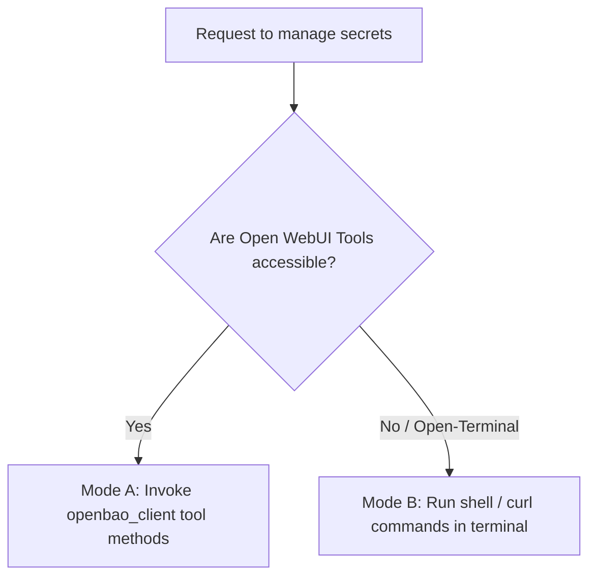

# OpenBao KV Secrets Management Skill

This skill guides the inspection, operation, testing, and troubleshooting of OpenBao / HashiCorp Vault Key-Value (KV v2) secrets engines. It supports two execution environments:
1. **Mode A: Open WebUI Tool Client** — When the `openbao_client` Python tool is active in the chat.
2. **Mode B: Open Terminal / Shell Substrate** — When Open WebUI is using `open-terminal` and cannot invoke tools directly, allowing execution via bash, `curl`, `jq`, or the `bao` CLI.

---

## 1. Execution Mode Detection

Before attempting secret operations, determine your execution context:



- **Use Mode A** if the model has access to the function-calling interface (`read_secret`, `write_secret`, `list_secrets`).
- **Use Mode B** if you are operating inside an **Open Terminal** container/shell, or if tool calling fails with `Tool not found` or `Tools disabled`.

---

## 2. Mode A: Open WebUI Tool Reference

When tools are bound and accessible, call the Python tool functions directly:

### 1. List Secrets
- **Method**: `list_secrets(path=None)`
- **Vault Endpoint**: `GET /v1/{mount}/metadata/{path}?list=true`
- **Output**: Returns a list of secret keys available under the root mount or specified subpath.

### 2. Read Secret
- **Method**: `read_secret(path)`
- **Vault Endpoint**: `GET /v1/{mount}/data/{path}`
- **Output**: Returns a dictionary of key-value pairs stored in the latest version of the secret.

### 3. Write / Update Secret
- **Method**: `write_secret(path, data)`
- **Vault Endpoint**: `POST /v1/{mount}/data/{path}` with `{"data": data}`
- **Output**: Returns version metadata confirming the write.

### 4. Logout / Invalidate Session
- **Method**: `logout()`
- **Vault Endpoint**: `POST /v1/auth/token/revoke-self`
- **Output**: Revokes the active session token server-side.

### Configuration (Valves & UserValves)
- **Tool Valves (`Valves`)**: Set by admin under **Workspace > Tools > Settings** (`OPENBAO_ADDR`, `SECRETS_MOUNT`, `OPENBAO_SKIP_TLS_VERIFY`, `REQUEST_TIMEOUT`).
- **User Valves (`UserValves`)**: Set by individual users under chat **Controls > Valves** (`OPENBAO_USERNAME`, `OPENBAO_PASSWORD`).

---

## 3. Mode B: Open Terminal / Shell Playbook

When running inside an **Open Terminal** shell session without access to Open WebUI tools, execute operations directly using `curl` and `jq`, or the `bao` CLI.

### 1. Setup Environment Variables

Define the target Vault instance and credentials:

```bash
export OPENBAO_ADDR="${OPENBAO_ADDR:-https://vault.spencer.lan}"
export SECRETS_MOUNT="${SECRETS_MOUNT:-kv}"
export OPENBAO_USERNAME="${OPENBAO_USERNAME:-}"
export OPENBAO_PASSWORD="${OPENBAO_PASSWORD:-}"
export CURL_TLS_FLAGS=""

# If using self-signed TLS certificates:
# export CURL_TLS_FLAGS="-k"
```

### 2. Authenticate & Obtain Client Token

Authenticate via the `userpass` auth engine using stdin streaming to avoid process table password leaks:

```bash
LOGIN_RESP=$(jq -n --arg pwd "$OPENBAO_PASSWORD" '{password: $pwd}' | \
  curl -sS $CURL_TLS_FLAGS -X POST "$OPENBAO_ADDR/v1/auth/userpass/login/$OPENBAO_USERNAME" \
    -H "Content-Type: application/json" \
    -d @-)

# Extract client token
export OPENBAO_TOKEN=$(echo "$LOGIN_RESP" | jq -r '.auth.client_token // empty')

if [ -z "$OPENBAO_TOKEN" ]; then
  echo "[-] Authentication failed:"
  echo "$LOGIN_RESP" | jq .
  return 1 2>/dev/null || exit 1
fi

echo "[+] Authenticated successfully with OpenBao."
```

### 3. List Secrets (KV v2)

KV v2 stores secret hierarchies under `/metadata`:

```bash
# List top-level secrets (null-safe traversal)
curl -sS $CURL_TLS_FLAGS -H "X-Vault-Token: $OPENBAO_TOKEN" \
  "$OPENBAO_ADDR/v1/$SECRETS_MOUNT/metadata?list=true" | jq -r '.data.keys[]? // empty'

# List subfolder secrets (e.g. apps/)
SUBFOLDER="apps"
curl -sS $CURL_TLS_FLAGS -H "X-Vault-Token: $OPENBAO_TOKEN" \
  "$OPENBAO_ADDR/v1/$SECRETS_MOUNT/metadata/$SUBFOLDER?list=true" | jq -r '.data.keys[]? // empty'
```

### 4. Read a Secret (KV v2)

KV v2 stores secret payload data at `/<mount>/data/<path>`:

```bash
SECRET_PATH="database/production"

curl -sS $CURL_TLS_FLAGS -H "X-Vault-Token: $OPENBAO_TOKEN" \
  "$OPENBAO_ADDR/v1/$SECRETS_MOUNT/data/$SECRET_PATH" | jq '.data.data'
```

To extract a single field:
```bash
curl -sS $CURL_TLS_FLAGS -H "X-Vault-Token: $OPENBAO_TOKEN" \
  "$OPENBAO_ADDR/v1/$SECRETS_MOUNT/data/$SECRET_PATH" | jq -r '.data.data.PASSWORD'
```

### 5. Write / Update a Secret (KV v2)

Send a JSON object wrapped inside a top-level `"data"` key:

```bash
SECRET_PATH="api/weather"

curl -sS $CURL_TLS_FLAGS -X POST "$OPENBAO_ADDR/v1/$SECRETS_MOUNT/data/$SECRET_PATH" \
  -H "X-Vault-Token: $OPENBAO_TOKEN" \
  -H "Content-Type: application/json" \
  -d '{
    "data": {
      "API_KEY": "sk-1234567890abcdef",
      "ENDPOINT": "https://api.weather.example.com",
      "TIMEOUT": "30"
    }
  }' | jq .
```

### 6. Delete Secrets

```bash
SECRET_PATH="api/weather"

# Soft delete latest version
curl -sS $CURL_TLS_FLAGS -X DELETE "$OPENBAO_ADDR/v1/$SECRETS_MOUNT/data/$SECRET_PATH" \
  -H "X-Vault-Token: $OPENBAO_TOKEN"

# Permanently destroy all versions & metadata
curl -sS $CURL_TLS_FLAGS -X DELETE "$OPENBAO_ADDR/v1/$SECRETS_MOUNT/metadata/$SECRET_PATH" \
  -H "X-Vault-Token: $OPENBAO_TOKEN"
```

### 7. Revoke Session Token on Exit

Always revoke your temporary session token when done:

```bash
curl -sS $CURL_TLS_FLAGS -X POST "$OPENBAO_ADDR/v1/auth/token/revoke-self" \
  -H "X-Vault-Token: $OPENBAO_TOKEN"
unset OPENBAO_TOKEN
```

---

## 4. Alternative: OpenBao / Vault CLI (`bao` / `vault`)

If the `bao` or `vault` binary is installed in Open Terminal:

```bash
# Set target address
export VAULT_ADDR="https://vault.spencer.lan"

# Authenticate via stdin to avoid exposing password in process tables
printf '%s\n' "$OPENBAO_PASSWORD" | bao login -method=userpass username="$OPENBAO_USERNAME" password=-

# List secrets
bao kv list kv/

# Read secret
bao kv get kv/database/production

# Write secret
bao kv put kv/api/weather API_KEY="sk-123" ENDPOINT="https://..."

# Destroy secret
bao kv metadata delete kv/api/weather
```

---

## 5. Standalone Python Script Execution (Open Terminal)

If Python is available in Open Terminal, you can run a self-contained Python script to fetch or write secrets:

```bash
python3 - << 'EOF'
import json, os, ssl, urllib.request

addr = os.getenv("OPENBAO_ADDR", "https://vault.spencer.lan").rstrip("/")
user = os.getenv("OPENBAO_USERNAME")
pwd = os.getenv("OPENBAO_PASSWORD")
mount = os.getenv("SECRETS_MOUNT", "kv")
skip_tls = os.getenv("OPENBAO_SKIP_TLS_VERIFY", "false").lower() in ("true", "1", "yes")

ctx = ssl.create_default_context()
if skip_tls:
    ctx.check_hostname = False
    ctx.verify_mode = ssl.CERT_NONE

# 1. Login
login_data = json.dumps({"password": pwd}).encode("utf-8")
req = urllib.request.Request(f"{addr}/v1/auth/userpass/login/{user}", data=login_data, headers={"Content-Type": "application/json"})
with urllib.request.urlopen(req, context=ctx, timeout=15) as resp:
    token = json.loads(resp.read().decode())["auth"]["client_token"]

# 2. Read Secret
secret_path = "database/production"
req = urllib.request.Request(f"{addr}/v1/{mount}/data/{secret_path}", headers={"X-Vault-Token": token})
with urllib.request.urlopen(req, context=ctx, timeout=15) as resp:
    secret = json.loads(resp.read().decode())["data"]["data"]
    print("Retrieved secret keys:", list(secret.keys()))
EOF
```

---

## 6. Troubleshooting Common Issues

| Issue / Error | Cause | Resolution |
| :--- | :--- | :--- |
| **`Tools disabled / Tool not found`** | Open WebUI is using `open-terminal` without Python tool bindings. | Switch to **Mode B** and use the `curl` or `bao` CLI commands above. |
| **`404 Not Found on /data or /metadata`** | Wrong KV mount or invalid v2 path structure. | Verify `SECRETS_MOUNT` (default is `kv`). KV v2 paths must be `.../data/<path>` for reads/writes and `.../metadata/<path>` for listings. |
| **`403 Forbidden`** | Session token expired, or userpass policy lacks capabilities. | Re-authenticate to refresh `OPENBAO_TOKEN`. Ensure policy allows `read`/`list`/`create`/`update` on `kv/data/*` and `kv/metadata/*`. |
| **`SSL: certificate verify failed`** | Self-signed or private CA certificate. | In Open Terminal, pass `-k` to `curl` or set `export VAULT_SKIP_VERIFY=1`. In Mode A, set `OPENBAO_SKIP_TLS_VERIFY=True` in Valves. |
