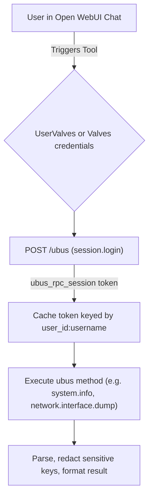

# OpenWrt Router Management Skill

This skill guides the operation, diagnostic procedures, and troubleshooting of OpenWrt routers using the Open WebUI client ([`tools/openwrt_client.py`](file:///Users/jspencer/projects/open-webui_tools/tools/openwrt_client.py)) via the `ubus` JSON-RPC interface.

---

## 1. Architecture & Protocol

OpenWrt exposes its internal micro-bus (`ubus`) over HTTP/HTTPS via `uhttpd` and the `rpcd` daemon at the `/ubus` endpoint.



### Authentication & Multi-Tenant Security
1. **Per-User Token Isolation**:
   - Session tokens are isolated per Open WebUI user (`__user__["id"]:username`). Unprivileged users cannot hijack administrator sessions.
2. **Session Persistence & Invalidation**:
   - If a call returns ubus error code `6` (Permission denied / session expired), the client invalidates the cached session, logs in again, and retries the operation transparently.
3. **Safe Ubus Allowlist & Redaction**:
   - `call_ubus` disallows dangerous methods (`file.exec`, `file.write`) and requires an administrator role for non-allowlisted methods.
   - `uci_get` automatically redacts sensitive keys (Wi-Fi PSKs, VPN private keys, passwords) to prevent data exfiltration.

---

## 2. Configuration Tiers

### Tool-Level Valves (`Valves`)
Configured in Open WebUI under **Workspace > Tools > Settings**:
- `OPENWRT_URL`: Router address (e.g., `http://192.168.1.1` or `https://router.lan`).
- `OPENWRT_RPC_PATH`: ubus endpoint path (default: `/ubus`).
- `OPENWRT_SKIP_TLS_VERIFY`: Set to `True` if using HTTPS with OpenWrt's default self-signed certificate.
- `REQUEST_TIMEOUT`: HTTP connection/read timeout in seconds (default: 10s).
- `OPENWRT_USERNAME` / `OPENWRT_PASSWORD`: Optional fallback credentials.

### User-Specific Valves (`UserValves`)
Configured by each user under chat session **Controls > Valves**:
- `OPENWRT_USERNAME`: Router username (e.g. `root`).
- `OPENWRT_PASSWORD`: Router login password (masked input).

---

## 3. Tool Methods & Common Tasks

### 1. System Health & Resource Diagnostics
- **Method**: `get_system_info()`
- **Ubus objects**: `system.info`, `system.board`
- **Output**: Hardware model, OpenWrt release/kernel version, uptime, 1/5/15 minute CPU load averages, memory (total/free/buffered), and swap usage.

### 2. Network Interface & WAN Status
- **Method**: `get_network_status()`
- **Ubus object**: `network.interface.dump`
- **Output**: All active interfaces (LAN, WAN, WAN6, guest), assigned IPv4/IPv6 addresses with CIDR netmasks, DNS servers, and interface uptime.

### 3. Connected Devices & DHCP Leases
- **Method**: `get_dhcp_leases()`
- **Ubus objects**: `luci-rpc.getDHCPLeases` $\rightarrow$ `dhcp.ipv4leases` $\rightarrow$ `/tmp/dhcp.leases` fallback.
- **Output**: List of devices currently holding DHCP leases, including hostname, assigned IP, MAC address, and lease expiration.

### 4. Wi-Fi Radios & Clients
- **Method**: `get_wireless_status()`
- **Ubus object**: `network.wireless.status`
- **Output**: Wireless physical devices (`radio0`, `radio1`), operating channels, disabled status, and configured SSIDs/interfaces.

### 5. Inspecting UCI Configuration
- **Method**: `uci_get(config, section=None, option=None)`
- **Safety**: Passwords and private keys are masked with `******`.
- **Examples**:
  - `uci_get(config="network")`: Inspect interface and VLAN settings.
  - `uci_get(config="wireless")`: Inspect Wi-Fi settings and radio modes.
  - `uci_get(config="firewall")`: Inspect port forwards, zones, and rules.
  - `uci_get(config="dhcp")`: Inspect dnsmasq and DHCP pool configurations.

### 6. Executing Ubus Procedures
- **Method**: `call_ubus(object_name, method, params=None)`
- **Security**: Safe read-only methods (`system`, `network.interface`, `network.wireless`, `dhcp`, `luci-rpc`) are open to all users; other procedures require an administrator role. `file.exec` and `file.write` are strictly forbidden.

### 7. Controlled System Reboot
- **Method**: `reboot_system(confirm=True)`
- **Safety**: Requires `confirm=True` and administrator privileges. Abrupt socket disconnects upon reboot are handled gracefully.

---

## 4. Router Prerequisites & Requirements

For the client to communicate with OpenWrt, the router must have `uhttpd` and `rpcd` active (standard on OpenWrt installations with LuCI):

```bash
/etc/init.d/uhttpd status
/etc/init.d/rpcd status
```

---

## 5. Standalone CLI Runbook

To test router connectivity and verify credentials from the command line:

```bash
python3 tools/openwrt_client.py
```

### Interactive Python Test
```python
from tools.openwrt_client import Tools

with Tools() as tool:
    tool.valves.OPENWRT_URL = "http://192.168.1.1"
    tool.valves.OPENWRT_USERNAME = "root"
    tool.valves.OPENWRT_PASSWORD = "your-password"

    info = tool.get_system_info()
    print("Model:", info.get("model"))
    print("Uptime:", info.get("uptime_seconds"), "seconds")
```

---

## 6. Troubleshooting Common Issues

| Symptom / Error | Root Cause | Solution |
| :--- | :--- | :--- |
| **`PermissionError: error code 1 / 6`** | Bad username or password. | Re-verify credentials in `UserValves` or `Valves`. |
| **`ubus error code 4 (Not found)`** | The requested ubus object (e.g. `luci-rpc`) is not installed. | The client automatically falls back; install `rpcd-mod-luci` or `rpcd-mod-file` on OpenWrt if needed. |
| **`Connection refused / 404 Not Found`** | uHTTPd is not running, or `/ubus` path is non-standard. | Ensure `/etc/init.d/uhttpd start` is running and `OPENWRT_RPC_PATH` is set to `/ubus`. |
| **`SSL: CERTIFICATE_VERIFY_FAILED`** | OpenWrt is using a self-signed HTTPS certificate. | Set `OPENWRT_SKIP_TLS_VERIFY=True` in tool Valves settings. |
| **`Missing credentials`** | Neither `UserValves` nor `Valves` username/password set. | Configure credentials in Open WebUI chat controls or tool settings. |
