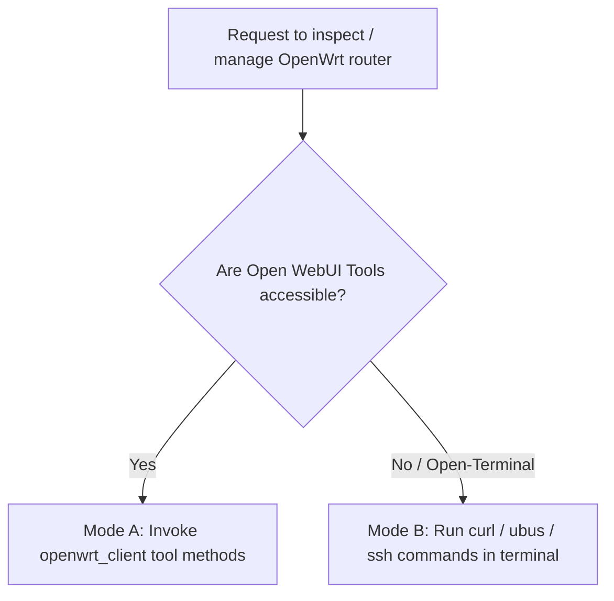

# OpenWrt Router Management Skill

This skill guides the operation, diagnostic procedures, and troubleshooting of OpenWrt routers. It supports two execution environments:
1. **Mode A: Open WebUI Tool Client** — When the `openwrt_client` Python tool is active in the chat.
2. **Mode B: Open Terminal / Shell Substrate** — When Open WebUI is using `open-terminal` and cannot invoke tools directly, allowing execution via bash, `curl`, `jq`, or direct SSH to the router.

---

## 1. Execution Mode Detection

Before running router operations, determine your execution context:



- **Use Mode A** if the model has access to the function-calling interface (`get_system_info`, `get_network_status`, `get_dhcp_leases`, etc.).
- **Use Mode B** if you are operating inside an **Open Terminal** container/shell, or if tool calling fails with `Tool not found` or `Tools disabled`.

---

## 2. Mode A: Open WebUI Tool Reference

When tools are bound and accessible, call the Python tool functions directly:

### 1. System Health & Resource Diagnostics
- **Method**: `get_system_info()`
- **Ubus Objects**: `system.info`, `system.board`
- **Output**: Model, OpenWrt release/kernel version, uptime, load averages, memory, and swap usage.

### 2. Network Interface & WAN Status
- **Method**: `get_network_status()`
- **Ubus Object**: `network.interface.dump`
- **Output**: Active interfaces (LAN, WAN, WWAN), assigned IPv4/IPv6 addresses, DNS, and uptime.

### 3. Connected Devices & DHCP Leases
- **Method**: `get_dhcp_leases()`
- **Ubus Objects**: `luci-rpc.getDHCPLeases` $\rightarrow$ `dhcp.ipv4leases` fallback.
- **Output**: List of active DHCP leases (hostname, assigned IP, MAC address, expiration).

### 4. Wi-Fi Radios & Clients
- **Method**: `get_wireless_status()`
- **Ubus Object**: `network.wireless.status`
- **Output**: Physical radios (`radio0`, `radio1`), channels, SSIDs, and client associations.

### 5. Inspecting UCI Configuration
- **Method**: `uci_get(config, section=None, option=None)`
- **Safety**: Passwords and private keys are masked with `******`.
- **Examples**: `uci_get(config="network")`, `uci_get(config="wireless")`, `uci_get(config="firewall")`.

### 6. Executing Ubus Procedures
- **Method**: `call_ubus(object_name, method, params=None)`
- **Security**: Safe read-only methods are open to all users; non-allowlisted methods require Open WebUI admin role. `file.exec` and `file.write` are strictly forbidden.

### 7. Controlled System Reboot
- **Method**: `reboot_system(confirm=True)`
- **Safety**: Requires `confirm=True` and administrator privileges.

### Configuration (Valves & UserValves)
- **Tool Valves (`Valves`)**: Set by admin under **Workspace > Tools > Settings** (`OPENWRT_URL`, `OPENWRT_RPC_PATH`, `OPENWRT_SKIP_TLS_VERIFY`, `REQUEST_TIMEOUT`).
- **User Valves (`UserValves`)**: Set by users under chat **Controls > Valves** (`OPENWRT_USERNAME`, `OPENWRT_PASSWORD`).

---

## 3. Mode B: Open Terminal / Shell Playbook (ubus JSON-RPC via curl)

When operating inside an **Open Terminal** shell without access to Open WebUI tools, communicate with OpenWrt's `rpcd` / `uhttpd` `/ubus` endpoint using `curl` and `jq`.

### 1. Setup Environment Variables

```bash
export OPENWRT_URL="${OPENWRT_URL:-http://192.168.1.1}"
export OPENWRT_RPC_PATH="${OPENWRT_RPC_PATH:-/ubus}"
export OPENWRT_USERNAME="${OPENWRT_USERNAME:-root}"
export OPENWRT_PASSWORD="${OPENWRT_PASSWORD:-}"
export CURL_TLS_FLAGS=""

# If router uses self-signed HTTPS:
# export CURL_TLS_FLAGS="-k"
```

### 2. Authenticate & Obtain `ubus_rpc_session` Token

Log into `/ubus` using `session.login` (using the bootstrap session ID `00000000000000000000000000000000`):

```bash
LOGIN_PAYLOAD=$(cat <<EOF
{
  "jsonrpc": "2.0",
  "id": 1,
  "method": "call",
  "params": [
    "00000000000000000000000000000000",
    "session",
    "login",
    {
      "username": "$OPENWRT_USERNAME",
      "password": "$OPENWRT_PASSWORD"
    }
  ]
}
EOF
)

LOGIN_RESP=$(curl -sS $CURL_TLS_FLAGS -X POST "$OPENWRT_URL$OPENWRT_RPC_PATH" \
  -H "Content-Type: application/json" \
  -d "$LOGIN_PAYLOAD")

export UBUS_SESSION=$(echo "$LOGIN_RESP" | jq -r '.result[1].ubus_rpc_session // empty')

if [ -z "$UBUS_SESSION" ]; then
  echo "[-] OpenWrt authentication failed:"
  echo "$LOGIN_RESP" | jq .
  return 1 2>/dev/null || exit 1
fi

echo "[+] Authenticated with OpenWrt ubus (Session: ${UBUS_SESSION:0:8}...)"
```

### 3. Reusable Ubus Helper Function

Define a helper function in your terminal session to make ubus calls concise:

```bash
ubus_call() {
  local obj="$1"
  local method="$2"
  local params="${3:-{}}"

  curl -sS $CURL_TLS_FLAGS -X POST "$OPENWRT_URL$OPENWRT_RPC_PATH" \
    -H "Content-Type: application/json" \
    -d "{
      \"jsonrpc\": \"2.0\",
      \"id\": 1,
      \"method\": \"call\",
      \"params\": [\"$UBUS_SESSION\", \"$obj\", \"$method\", $params]
    }"
}
```

### 4. System Health & Hardware Diagnostics

```bash
# Board model, architecture, release, and kernel
ubus_call system board | jq '.result[1]'

# Uptime, load averages, memory, and swap
ubus_call system info | jq '.result[1] | {
  uptime_seconds: .uptime,
  load: .load,
  memory_total_mb: (.memory.total / 1048576 | round),
  memory_free_mb: (.memory.free / 1048576 | round)
}'
```

### 5. Network Interfaces & IP Addresses

```bash
# List all active interfaces with IP addresses
ubus_call network.interface dump | jq '.result[1].interface[] | select(.up == true) | {
  interface: .interface,
  device: .l3_device,
  ipv4: [ .["ipv4-address"][]? | "\(.address)/\(.mask)" ],
  uptime: .uptime
}'
```

### 6. Connected Devices & DHCP Leases

```bash
# Query active DHCP leases
DHCP_OUT=$(ubus_call luci-rpc getDHCPLeases)

if echo "$DHCP_OUT" | jq -e '.result[1].dhcp_leases' > /dev/null 2>&1; then
  echo "$DHCP_OUT" | jq '.result[1].dhcp_leases[] | {hostname: .hostname, ip: .ipaddr, mac: .macaddr, expires: .expires}'
else
  # Fallback to dhcp ipv4leases
  ubus_call dhcp ipv4leases | jq '.result[1].device[].leases[] | {hostname: .hostname, ip: .ip, mac: .mac}'
fi
```

### 7. Wireless Radios & Wi-Fi Status

```bash
ubus_call network.wireless status | jq '.result[1] | to_entries[] | {
  radio: .key,
  up: .value.up,
  disabled: .value.disabled,
  channel: .value.config.channel,
  ssids: [ .value.interfaces[]?.config.ssid ]
}'
```

### 8. Inspecting UCI Configuration

```bash
# Read network UCI configuration
ubus_call uci get '{"config": "network"}' | jq '.result[1].values'

# Read wireless UCI configuration (filter out sensitive keys like key/password)
ubus_call uci get '{"config": "wireless"}' | jq '
  walk(if type == "object" then with_entries(if .key | test("key|password|secret|token"; "i") then .value = "******" else . end) else . end) | .result[1].values
'

# Read firewall port forwards and rules
ubus_call uci get '{"config": "firewall"}' | jq '.result[1].values'
```

### 9. Controlled System Reboot

```bash
echo "[!] Rebooting OpenWrt router..."
ubus_call system reboot
```

---

## 4. Alternative: Direct SSH Access from Open Terminal

If the router has SSH enabled (`dropbear` on port 22) and accessible from Open Terminal:

```bash
ROUTER_HOST="192.168.1.1"

# Run remote ubus commands directly on the router CLI
ssh root@$ROUTER_HOST "ubus call system info; cat /tmp/dhcp.leases"

# Inspect active wireless associations
ssh root@$ROUTER_HOST "iwinfo"

# Query UCI configuration
ssh root@$ROUTER_HOST "uci show network"
```

---

## 5. Troubleshooting Common Issues

| Symptom / Error | Root Cause | Solution |
| :--- | :--- | :--- |
| **`Tools disabled / Tool not found`** | Open WebUI is using `open-terminal` without Python tool bindings. | Switch to **Mode B** and use the `curl` ubus helper or direct `ssh` above. |
| **`error code 6 (Permission denied)`** | Invalid password or ubus session expired. | Re-run the `session.login` step to obtain a fresh `UBUS_SESSION` token. |
| **`error code 4 (Not found)`** | The requested ubus object (e.g. `luci-rpc`) is not installed on OpenWrt. | Use the standard `dhcp ipv4leases` fallback or install `rpcd-mod-luci` on OpenWrt. |
| **`Connection refused / 404 Not Found`** | uHTTPd web server is not running on the router. | Run `/etc/init.d/uhttpd start` on the router or verify `OPENWRT_RPC_PATH` is `/ubus`. |
| **`SSL: CERTIFICATE_VERIFY_FAILED`** | Router uses self-signed HTTPS certificate. | Pass `-k` to `curl` in Open Terminal, or set `OPENWRT_SKIP_TLS_VERIFY=True` in Mode A. |
